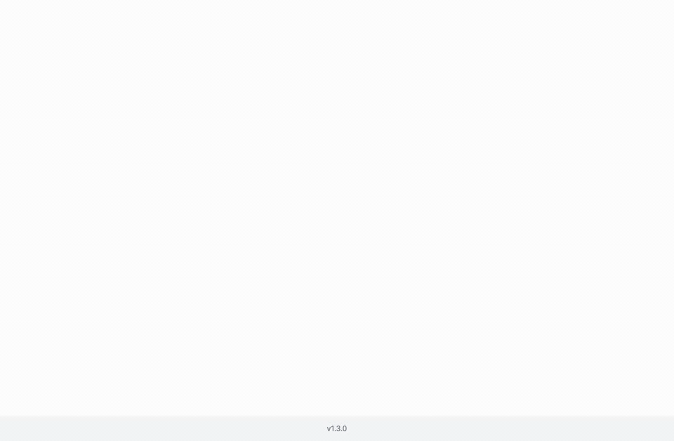
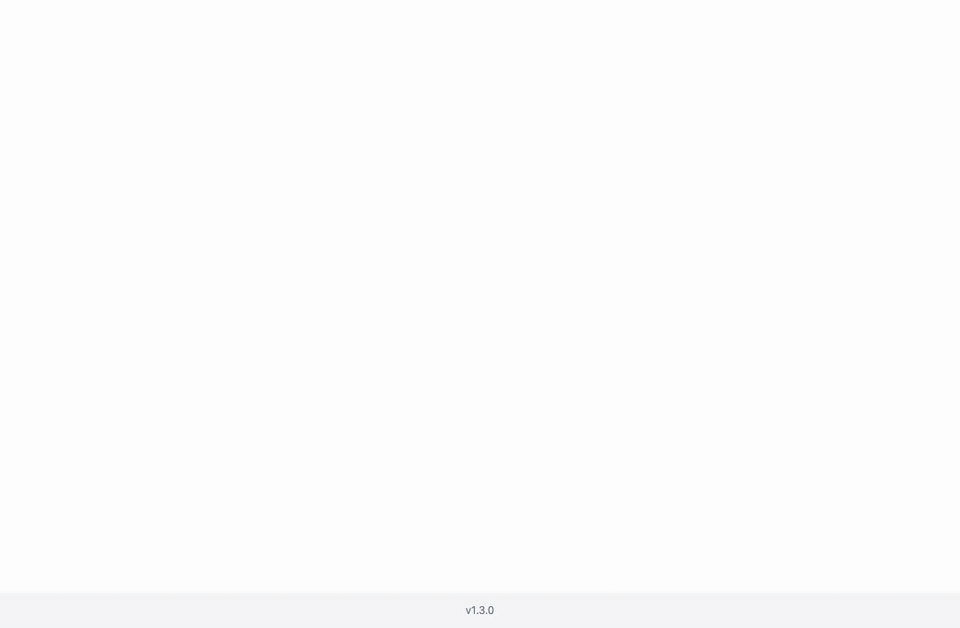

# blog-app

Portable **Angular** blog with a Cognito-protected **admin** and an **AWS SAM** API (HTTP API, Lambda, DynamoDB, S3 media, scheduled publish).

One codebase, many sites: swap domain, AWS account, and branding via environment config. This repo is **source you build from your own CI** — keep secrets out of the public tree.

Author: Logan Born · License: MIT

## How it looks

Local **demo mode** (`useDemoData: true`) ships example posts so you can run the UI without an API. GIFs below were captured from that mode.

### Browse the index

Archive rail + sort/date filters:


### Open a post



### Admin (demo sign-in)

Drafts, scheduled, and published posts — edit without Cognito when demo mode is on:



```bash
npm start                 # then open /blog and /blog/admin
npm run capture:gifs      # refresh GIFs (server must be running)
```

## Features

- Public index with date filters and a year/month archive rail
- Post pages with rich HTML body and images
- Admin: drafts, TipTap editor, image upload, publish / schedule / unpublish
- Revision history + restore
- Google sign-in via Cognito (email allowlist)
- Optional home link back to a parent site (omit for a standalone blog)
- Configurable image layout: **column** (centered photo stack) or **inline** (classic article flow)
- Local demo data (`src/app/blog/example-posts.ts`)

## Stack

| Layer | Tech |
|-------|------|
| Frontend | Angular 22, Tailwind CSS, TipTap |
| Auth | Cognito Hosted UI + Google IdP (PKCE) |
| API | AWS SAM, Node 22 Lambda, HTTP API |
| Data | DynamoDB (posts + revisions), S3 (media) |

## Repo layout

```
src/app/blog/     Public UI, API client, example/demo posts
src/app/admin/    Login, auth, TipTap editor
api/blog/         SAM template + Lambda handler
src/environments/ Per-deploy config
docs/gifs/        README demo captures
scripts/          GIF capture + example-post tests
```

## Quick start

```bash
npm install
npm start
```

With `useDemoData: true` (default in `environment.ts`):

| URL | What you get |
|-----|----------------|
| `http://localhost:4200/blog` | Example published posts |
| `http://localhost:4200/blog/admin` | Demo admin (no Google login) |

For a real backend, set `useDemoData: false` and fill Cognito + `blogApiUrl` (see `environment.example.ts`).

```bash
npm test                 # example posts + demo store
npm run capture:gifs     # regenerate README GIFs
```

## Configure a site

Edit `src/environments/environment.ts` (local) / `environment.prod.ts` (CI):

| Field | Purpose |
|-------|---------|
| `useDemoData` | In-memory example posts + demo admin (no API/Cognito) |
| `siteName` | Blog title / branding |
| `siteHomeUrl` / `siteHomeLabel` | Optional link to a parent site; leave empty for standalone |
| `appBasePath` | App path prefix (default `/blog`) |
| `imageLayout` | `column` (trip photo diary) or `inline` (side-by-side article flow) |
| `blogApiUrl` | Deployed API base URL |
| `cognito.*` | Pool, client, domain, redirect/logout URIs, email allowlist |

Cognito redirect URIs should match your domain (e.g. `https://YOUR_DOMAIN/blog/admin` and `https://YOUR_DOMAIN/blog/`).

Production branding and API URLs belong in **CI secrets** that write `environment.prod.ts` at build time — not in committed env files.

## Deploy API (per site)

1. Create a Cognito user pool + app client + Google IdP + hosted UI domain.
2. Allowlist callback and logout URLs for your domain (and localhost for dev).
3. From `api/blog`:

```bash
npm install --prefix src
sam build
sam deploy --guided
```

Use a unique stack/prefix per site so tables, buckets, and APIs stay isolated.

## Deploy frontend (your CI)

Typical pattern:

1. Check out this repo at a pinned ref.
2. Write `environment.prod.ts` from CI secrets (`useDemoData: false`).
3. `npm ci && npx ng build --configuration production`
4. Upload `dist/` and invalidate your CDN.
5. If the blog lives under a path (e.g. `/blog`), point CDN path rules at the blog origin and keep SPA routing for `/blog` and `/blog/*`.

## Multi-site

One repo, separate AWS stacks (and usually separate Cognito pools):

| Site | Stack prefix | Domain | Env |
|------|--------------|--------|-----|
| Site A | `site-a` | a.example.com | A’s Cognito + API |
| Site B | `site-b` | b.example.com | B’s Cognito + API |

Same code; separate data, billing, and auth.

## Security

Env files here use **placeholders**. Real Cognito IDs, API URLs, and allowlists belong in private CI secrets or a private deploy config.

## License

MIT
