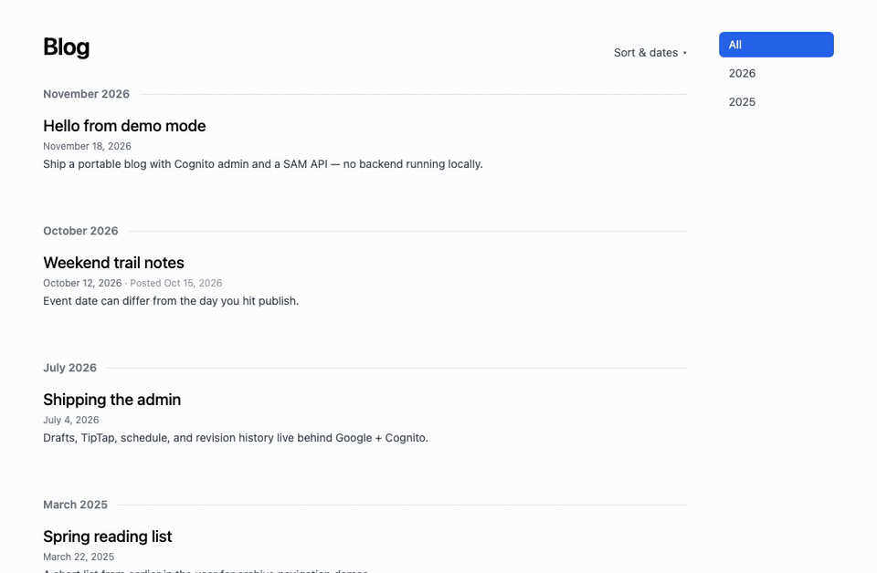

# blog-app

A portable **Angular blog** with Cognito-protected **admin** and an **AWS SAM** backend (API Gateway HTTP API, Lambda, DynamoDB, S3 media, scheduled publish).

Same codebase can power multiple sites — different domains, AWS accounts, and branding — via environment config. This repo is intended as **source you build and deploy from your own CI**; keep secrets out of the public tree.

## How it looks

Local **demo mode** (`useDemoData: true`) ships example posts so you can run the UI without an API. GIFs below were captured from that mode.

### Browse the index

Archive rail + sort/date filters:



### Open a post


### Admin (demo sign-in)

Drafts, scheduled, and published posts — edit without Cognito when demo mode is on:


Regenerate GIFs (with `npm start` running):

```bash
npm run capture:gifs
```

## Features

- Public blog index with date filters and year/month archive rail
- Post pages with rich HTML body and images
- Admin UI: drafts, TipTap editor, image upload, publish / schedule / unpublish
- Revision history + restore
- Google sign-in via Amazon Cognito (email allowlist)
- Configurable site name; optional “home” link if the blog sits under a larger site (omit for a standalone blog)
- Local demo data + example posts (`src/app/blog/example-posts.ts`)

## Stack

| Layer | Tech |
|-------|------|
| Frontend | Angular 22, Tailwind CSS, TipTap |
| Auth | Cognito Hosted UI + Google IdP (PKCE) |
| API | AWS SAM, Node 22 Lambda, HTTP API |
| Data | DynamoDB (posts + revisions), S3 (media) |

## Repo layout

```
src/app/blog/     Public blog UI + API client + example/demo posts
src/app/admin/    Login, auth, admin editor
api/blog/         SAM template + Lambda handler
src/environments/ Per-deploy config (API URL, Cognito, allowlist, home link)
docs/gifs/        README demo captures
scripts/          GIF capture + example-post tests
```

## Quick start (frontend)

```bash
npm install
npm start
```

With `useDemoData: true` (default in `environment.ts`), open:

- `http://localhost:4200/blog` — example posts
- `http://localhost:4200/blog/admin` — demo admin (no Google login)

To talk to a real API instead, set `useDemoData: false` and fill Cognito + `blogApiUrl` (see `environment.example.ts`).

```bash
npm test                 # example posts + demo store
npm run capture:gifs     # refresh README GIFs (server must be up)
```

## Configure a site

Edit `src/environments/environment.ts` (local) / `environment.prod.ts` (CI):

| Field | Purpose |
|-------|---------|
| `useDemoData` | In-memory example posts + demo admin (no API/Cognito) |
| `siteName` | Blog title / branding |
| `siteHomeUrl` / `siteHomeLabel` | Optional link back to a parent site; leave empty for a standalone blog |
| `appBasePath` | App path prefix (default `/blog`) |
| `blogApiUrl` | Deployed API base URL |
| `cognito.*` | Pool, client, domain, redirect/logout URIs, email allowlist |

Redirect URIs should match Cognito (e.g. `https://YOUR_DOMAIN/blog/admin` and `https://YOUR_DOMAIN/blog/`).

## Deploy API (per site)

1. Create a Cognito user pool + app client + Google IdP + hosted UI domain.
2. Allowlist callback and logout URLs for your domain (and localhost for dev).
3. From `api/blog`:

```bash
npm install --prefix src
sam build
sam deploy --guided
```

Use a unique stack/prefix per site so tables, buckets, and APIs stay isolated.

## Deploy frontend (your CI)

Build this app in your host project’s pipeline (or a private deploy repo), inject production env from secrets, then sync `dist/` to S3 (or your static host). Typical pattern:

1. Check out this repo at a pinned ref.
2. Write `environment.prod.ts` from CI secrets (`useDemoData: false`).
3. `npm ci && npx ng build --configuration production`
4. Upload `dist/` and invalidate your CDN.
5. If the blog lives under a path on an existing domain (e.g. `/blog`), point CDN path rules at the blog origin; keep SPA routing working for `/blog` and `/blog/*`.

Do **not** put Cognito IDs, API URLs, or allowlisted emails into this public repo’s committed env files.

## Multi-site

One repo, separate AWS stacks (and usually separate Cognito pools):

| Site | Stack prefix | Domain | Env |
|------|--------------|--------|-----|
| Site A | `site-a` | a.example.com | A’s Cognito + API |
| Site B | `site-b` | b.example.com | B’s Cognito + API |

Same code; separate data, billing, and auth.

## Security note

Env files here use **placeholders**. Real credentials and allowlists belong in private CI secrets or a private deploy config.

## License

MIT
